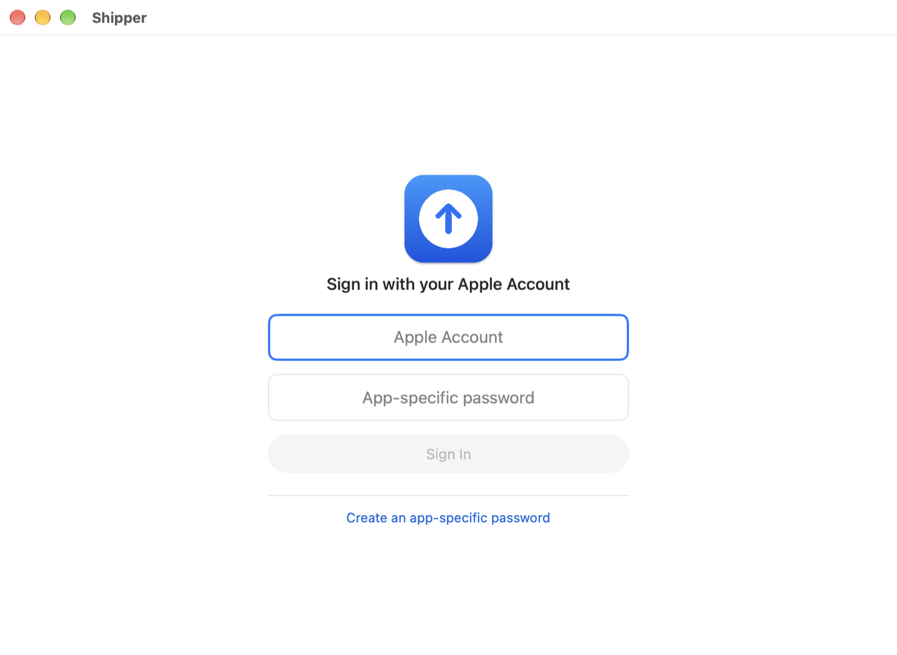
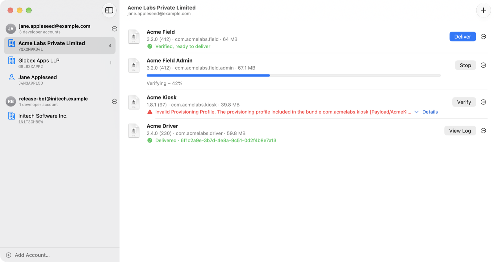
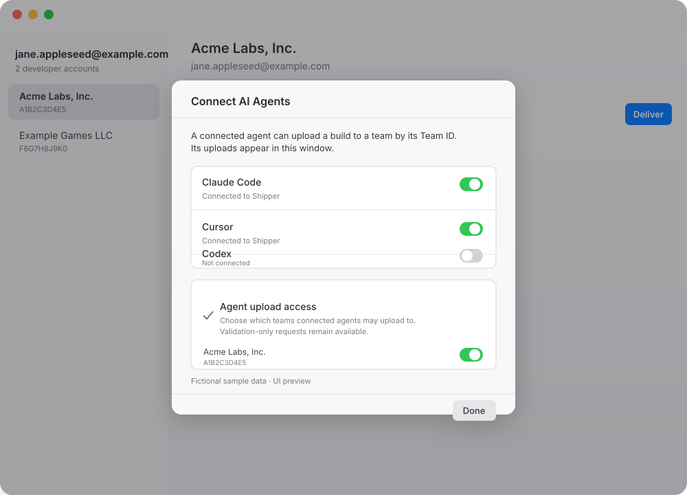

<p align="center"></p>

# Shipper

A small macOS app for sending `.ipa` and `.pkg` builds to App Store Connect, modeled on Apple's Transporter.
Sign in to several Apple Accounts at once, pick the developer account (team) a build belongs to, drop the
file in, and Shipper verifies it on its own. When verification passes, a **Deliver** button appears.

## Contents

- [Features](#features)
- [Requirements](#requirements)
- [How to install (.dmg file or plugin)](#how-to-install-dmg-file-or-plugin)
- [Use Shipper](#use-shipper)
- [Use with AI agents](#use-with-ai-agents)
- [Standalone AI agent tools for ChatGPT, Claude, and others](#standalone-ai-agent-tools-for-chatgpt-claude-and-others)
- [Why an app-specific password?](#why-an-app-specific-password)
- [Checking Apple's processing status](#checking-apples-processing-status)
- [Security](#security)
- [Build from source](#build-from-source)
- [How it works](#how-it-works)
- [License](#license)

<table>
  <tr>
    <td align="center"><a href="docs/screenshots/sign-in.png"></a><br><sub>Sign in</sub></td>
    <td align="center"><a href="docs/screenshots/home.png"></a><br><sub>Home</sub></td>
    <td align="center"><a href="docs/screenshots/connect-ai-preview.svg"></a><br><sub>Connect AI preview</sub></td>
  </tr>
</table>

<sub>Accounts, teams and builds in the screenshots are made up.</sub>

## Features

- **Several Apple Accounts at once.** Add accounts from the sidebar; no signing out to switch.
- **Every developer account under each Apple Account**, with its Team ID, the same list App Store Connect
  shows in its account menu. Select one to see and add only that team's builds. The selection is remembered.
- **Verify on add.** Dropping a build starts `altool --validate-app` right away with a progress bar.
  **Deliver** (`altool --upload-package`) is offered only after verification passes.
- **Track Apple's processing.** Add an App Store Connect API key for each developer team and Shipper checks whether Apple
  accepts or rejects each upload. Processing failures appear in the queue and as a macOS notification. Without an
  API key, Shipper reports that the upload completed but processing could not be checked.
- Version, build number and bundle ID read straight from the `.ipa` or `.pkg`.
- When verification or delivery fails, a one-line error appears under the build. **Details** expands the full
  message; failed preflight checks also show suggested fixes and can be copied as a validation report.
- Per-build log, Stop, Retry, Show in Finder. You can stop Apple's background processing check and resume it later.
- The selected team's header includes a shortcut to App Store Connect.
- Open `.ipa` and `.pkg` files from Finder with Shipper.
- **Works with AI agents.** Claude Code, Cursor and other MCP clients can upload a build to a team by its
  Team ID. See [Use with AI agents](#use-with-ai-agents).
- **Updates itself.** At launch and once a day Shipper checks this repo for a newer version, downloads it in
  the background and installs it when you quit, or right away with **Relaunch Now**. An update is installed
  only if it's signed by the same certificate as the copy you're running. **Shipper → Check for Updates…**
  checks now; **Install Updates Automatically** in the same menu turns it off.

## Requirements

- macOS 14 or later, Apple silicon or Intel.
- **Xcode** installed. Shipper drives `xcrun altool`, which ships with Xcode.
- An Apple Account with access to App Store Connect, plus an
  [app-specific password](https://support.apple.com/102654) for it.

## How to install (.dmg file or plugin)

1. Download **[Shipper.dmg](https://github.com/huygenlabs/shipper/raw/main/Shipper.dmg)**.
2. Open it and drag **Shipper** into **Applications**.
3. First launch only: Shipper is not notarized by Apple (see [Security](#security)), so macOS blocks it.
   Open it once, then go to **System Settings → Privacy & Security** and click **Open Anyway**.
   Or, from Terminal:

   ```sh
   xattr -dr com.apple.quarantine /Applications/Shipper.app
   ```

To check the download isn't corrupted, compare its checksum. The checksum lives in this same repo, so it
can't reveal a tampered repo. If that matters to you, build from source instead.

To install only the AI tools without the Shipper app, see
[Standalone AI agent tools](#standalone-ai-agent-tools-for-chatgpt-claude-and-others).

```sh
shasum -a 256 ~/Downloads/Shipper.dmg
# 74cd4896cc24f90897ce4f08bf06bee2ab705ca91efe01a8b9e8f7481db89b8b
```

## Use Shipper

1. Sign in with your Apple Account email and an **app-specific password** (not your normal password).
2. Pick a developer account in the sidebar.
3. Drag an `.ipa` or `.pkg` into the window, or press ⌘O. Verification starts on its own.
4. When it says **Verified, ready to deliver**, click **Deliver**.

The first time Shipper reads its saved password, macOS asks for your Mac password. Click **Always Allow** and it
won't ask again, including after updates.

### Use with AI agents

Shipper is also an [MCP](https://modelcontextprotocol.io) server, so an agent can upload the build it just
made. MCP has no system-wide registry: every agent keeps its own list of servers, so Shipper has to be added
to each one.

**Connect AI Agents…**, at the bottom of the sidebar and in the Shipper menu, has a switch for each agent it
finds on your Mac. Turning one on adds Shipper to that agent's MCP servers; turning it off takes it out.
Restart the agent afterwards.

Open **Agent upload access** in the same window to choose which developer teams agents may upload to.
Validation-only requests remain available for blocked teams. Teams already signed in when this control is introduced
keep their existing access; teams added later start disabled until you allow them.

| Agent | What the switch changes |
|---|---|
| Claude Code | runs `claude mcp add --scope user` (`~/.claude.json`) |
| Claude Desktop | `~/Library/Application Support/Claude/claude_desktop_config.json` |
| Cursor | `~/.cursor/mcp.json` |
| Codex | `~/.codex/config.toml` |
| Antigravity | `~/.gemini/config/mcp_config.json` |
| VS Code | `~/Library/Application Support/Code/User/mcp.json` |
| Windsurf | `~/.codeium/windsurf/mcp_config.json` |
| Gemini CLI | `~/.gemini/settings.json` |

Only Shipper's own entry is written or removed; the rest of the file is kept. A JSON config with comments is
left alone, because writing it back would lose them: add Shipper by hand instead.

This MCP setup delegates to the Shipper app, so it is for local AI clients. The standalone AI agent bundle
below works without the Shipper UI app. ChatGPT web and Claude in a browser cannot launch a local MCP process;
they need a separately hosted server, which would not directly read a build file on your Mac.

For any other agent, or by hand:

```sh
claude mcp add --scope user shipper -- /Applications/Shipper.app/Contents/MacOS/Shipper --mcp
```

```json
{
  "mcpServers": {
    "shipper": {
      "command": "/Applications/Shipper.app/Contents/MacOS/Shipper",
      "args": ["--mcp"]
    }
  }
}
```

| Tool | What it does |
|---|---|
| `list_teams` | The teams Shipper is signed in to, their Team IDs, and whether agent uploads are allowed. |
| `upload_build` | Validates the `.ipa` or `.pkg` at `path` for `team_id`, then uploads if validation passes and that team allows agent uploads. `verify_only` stops after validation and remains available for blocked teams. Results include validation findings and suggested next steps. |
| `list_builds` | The queue: validation, upload, Apple processing state, progress, delivery ID and errors. |

Sign in to your Apple Accounts in Shipper first. When an agent uploads, Shipper opens in the background and
the build appears in its queue like one you dropped in, with the same progress, log and Stop button. A team
that several of your Apple Accounts belong to is uploaded with the account selected in the sidebar if it has
that team, otherwise the first that does. If the agent stops waiting, the upload carries on; `list_builds`
tells it how the upload ended. The app's Stop control stops active validation, upload, or Apple status checking;
retrying a stopped or failed upload never resends a build that already has a delivery ID.

### Standalone AI agent tools for ChatGPT, Claude, and others

The standalone bundle provides a local MCP server and does not open or depend on the Shipper UI app. It can
list teams, validate a local build, and validate then upload an `.ipa` or `.pkg`. It does not show a queue
window or monitor Apple's post-upload processing; use App Store Connect to check processing status.

Use it with **ChatGPT Desktop** through Plugin Creator, or connect the same MCP server directly to **Claude
Code, Claude Desktop, Cursor, Codex, or another local MCP-compatible agent**. A regular ChatGPT or Claude
browser session cannot launch a process on your Mac. Each agent app needs its own connection to the local
server.

**Requirements:** macOS 14 or later and Xcode (for Apple's `xcrun altool`). ChatGPT Desktop is needed only if
you want to use the ChatGPT plugin.

Run this command to download the bundle and set up its local credentials:

```sh
curl -fsSL https://github.com/huygenlabs/shipper/raw/main/Shipper-ChatGPT-Plugin.zip \
  -o ~/Downloads/Shipper-ChatGPT-Plugin.zip && \
unzip -oq ~/Downloads/Shipper-ChatGPT-Plugin.zip -d ~/Downloads && \
cd ~/Downloads/Shipper-ChatGPT-Plugin && \
./mcp/shipper-mcp --setup
```

Configure each Apple Account once. The setup runs locally; the app-specific password is typed with terminal
echo off, validated with Apple, and saved in the macOS login Keychain. It is never a plugin tool argument or
sent in a ChatGPT message.

**ChatGPT Desktop:** install **Plugin Creator**, open Plugins, select **+**, and ask it to create a Desktop-only
Shipper plugin from the expanded bundle, keeping its `.mcp.json` local MCP server and `skills/shipper/SKILL.md`.
Review the tools and install the plugin.

**Claude Code:** add the standalone executable as a local MCP server:

```sh
claude mcp add --scope user shipper -- "$HOME/Downloads/Shipper-ChatGPT-Plugin/mcp/shipper-mcp"
```

**Claude Desktop and other MCP clients:** add the executable path to the client's MCP server configuration:

```json
{
  "mcpServers": {
    "shipper": {
      "command": "/Users/YOU/Downloads/Shipper-ChatGPT-Plugin/mcp/shipper-mcp",
      "args": []
    }
  }
}
```

Replace `/Users/YOU` with your Mac home folder, then restart the agent. Ask it to list teams or validate a
build. The ChatGPT plugin includes instructions to confirm the team and file before upload. With other
agents, ask them to confirm those details before uploading; the server always runs Apple's validation again
before delivering.

### Why an app-specific password?

Transporter signs in with your normal password through Apple's private AuthKit framework. Only apps signed
by Apple may use it, and Shipper doesn't try to get around that. `altool`, the supported command-line route,
takes an app-specific password instead. You can revoke one at any time at
[account.apple.com](https://account.apple.com/account/manage).

### Checking Apple's processing status

Apple's upload command can finish before Apple has processed the build. To have Shipper check the final result,
open a developer team's context menu in the sidebar and choose **Add App Store Connect API Key…**. Create a team
API key for that developer account, then enter its Key ID, Issuer ID and `.p8` private key. Shipper stores the private
key in the macOS Keychain and uses it only to read build status for that team. A rejected build appears as an error and triggers
a macOS notification. Apple does not expose the detailed processing report through this status endpoint, so open
the build in App Store Connect for Apple's full error details.

## Security

- **Passwords** are stored only in your login Keychain. They are handed to `altool` on standard input, so they
  never appear in process arguments (`ps`) or in the environment of any process. If the Keychain has no
  password (or you deny access), Shipper asks you to sign in again instead of trying an empty one, because
  repeated failed logins can lock an Apple Account. Signing out deletes the Keychain item.
- **Network:** Shipper makes HTTPS requests to GitHub for updates and to App Store Connect to check processing
  status when you configure an API key. Those status requests send the API token and build metadata to Apple.
  Uploads and account sign-ins go through Apple's `altool`.
  Update requests are plain HTTPS GETs of
  [`Info.plist`](https://raw.githubusercontent.com/huygenlabs/shipper/main/Info.plist) and, when it lists a newer
  version, `Shipper.dmg`, both from this repo. They send nothing about you or your accounts.
- **Updates** are checked before they're installed: the new `Shipper.app` must pass the installed copy's code
  signing requirement (same bundle ID, same signing certificate) and be a newer version. A tampered download
  or repo can't install an app signed by someone else. Shipper replaces itself only where you put it, and
  only when it can write there; otherwise it offers the download instead. Turn updates off with
  **Shipper → Install Updates Automatically**.
- **AI agents:** `Shipper --mcp` talks to the app over a Unix socket in
  `~/Library/Application Support/Shipper/` that only your user can open; the app also checks that the caller
  runs as you. Agents see team names, Team IDs and builds, never passwords or Apple Account emails, and can
  only queue `.ipa` and `.pkg` files given by absolute path. Be aware of what this allows: any program already
  running as you can ask Shipper to upload a build for any team enabled in **Agent upload access**, without a prompt.
  It can't read the passwords. Uploads always show in Shipper's queue, and a delivered build can't be deleted from
  App Store Connect, only expired. Shipper changes an agent's config file only when you flip that agent's
  switch in **Connect AI Agents…**.
- **Stored settings** (`~/Library/Preferences/io.github.huygenlabs.shipper.plist`): signed-in Apple Account
  emails, developer account names and IDs, API Key IDs, Issuer IDs and the last selection. No passwords or private keys.
- **App Store Connect API keys** are optional and separate from upload passwords. Their `.p8` private key is kept
  in the login Keychain; Shipper uses it to check processing status and deletes it when you sign out.
- **Builds you add** are read with `/usr/bin/tar` to show their version and bundle ID. Reads are capped at
  16 MB so a malformed archive can't exhaust memory, and nothing is extracted to disk.
- **Signing:** the app is signed with a self-signed certificate and the hardened runtime. It is **not notarized**,
  because notarizing needs a paid Developer ID certificate. That's why macOS asks you to approve the first
  launch. Building from source is the way to be sure of what you run. The certificate stays the same between
  releases, so the Keychain keeps trusting updated copies of Shipper.
- The app is not sandboxed, because it has to run `xcrun altool`.

## Build from source

```sh
git clone https://github.com/huygenlabs/shipper.git
cd shipper
swift test        # parsing and security checks
./build.sh        # build.noindex/Shipper.app (universal) and Shipper.dmg
```

On first run `build.sh` creates a self-signed code-signing certificate in its own keychain at
`~/Library/Application Support/Shipper/signing/`, outside the repo, protected by a random password that only
your user can read. Every build after that is signed with it, so
the app keeps the same identity and the Keychain doesn't ask for your Mac password after each rebuild.

To release an update, raise `CFBundleShortVersionString` (and `CFBundleVersion`) in `Info.plist`, run
`./build.sh`, update the checksum above, then commit and push. Installed copies see the new version in
`Info.plist` on `main`, download the new `Shipper.dmg` and install it. They only accept apps signed with the
same certificate, so release builds must come from the machine that holds the signing keychain. Back up
`~/Library/Application Support/Shipper/signing/`; without it, installed copies can't update automatically.

`make-icon.swift` redraws the app icon:
`swift make-icon.swift && iconutil -c icns build.noindex/AppIcon.iconset -o AppIcon.icns`.

## How it works

Transporter's upload engine is Apple's `ContentDelivery.framework`. Xcode ships the same framework, with
`altool` as its command-line front end. Shipper is a SwiftUI shell around it:

| Shipper | altool |
|---|---|
| Sign in, list developer accounts | `--list-providers --output-format json` |
| Verify | `--validate-app <file> --provider-public-id <id>` |
| Deliver | `--upload-package <file> --provider-public-id <id>` |

Code: `Sources/Shipper/Uploader.swift` (accounts, Keychain, altool, archive reading) and
`Sources/Shipper/App.swift` (UI), `Sources/Shipper/Updater.swift` (update check), `Sources/Shipper/MCP.swift`
(MCP server for AI agents and the socket it reaches the app through).

## License

Copyright © 2026 HuygenLabs. Shipper is open source under the [Apache License 2.0](LICENSE).

You may use, change and redistribute it, including in commercial products. If you distribute Shipper or
anything built from it, include the [LICENSE](LICENSE) and keep the credit to HuygenLabs from the
[NOTICE](NOTICE) file, as section 4 of the license requires.
