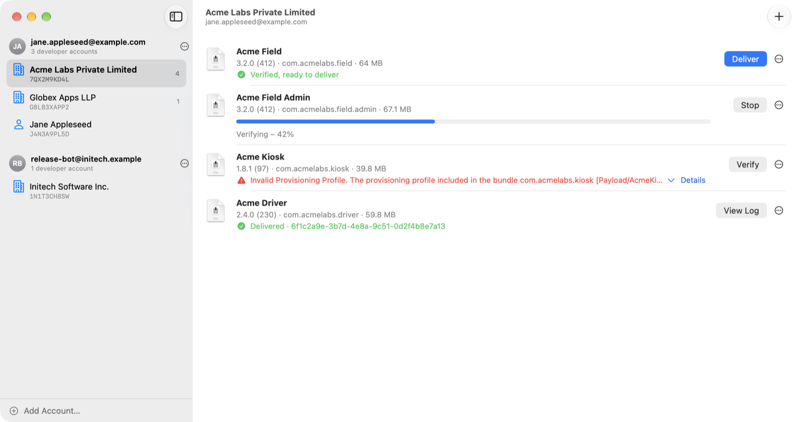
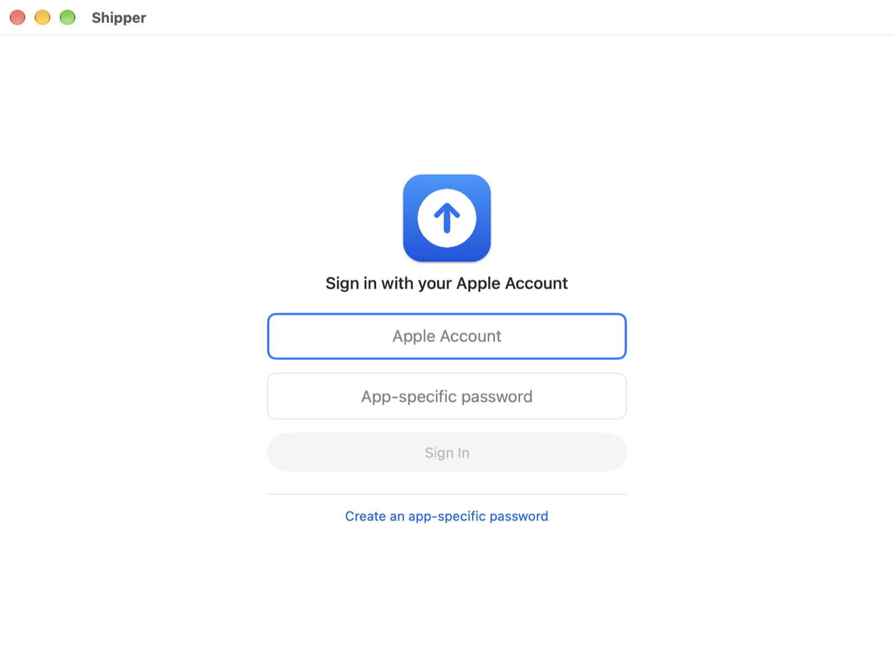

<p align="center"></p>

# Shipper

A small macOS app for sending `.ipa` and `.pkg` builds to App Store Connect, modeled on Apple's Transporter.
Sign in to several Apple Accounts at once, pick the developer account (team) a build belongs to, drop the
file in, and Shipper verifies it on its own. When verification passes, a **Deliver** button appears.

<picture>
  <source media="(prefers-color-scheme: dark)" srcset="docs/screenshots/home-dark.png">
  
</picture>

<p align="center"></p>

<sub>Accounts, teams and builds in the screenshots are made up.</sub>

## Features

- **Several Apple Accounts at once.** Add accounts from the sidebar; no signing out to switch.
- **Every developer account under each Apple Account**, with its Team ID, the same list App Store Connect
  shows in its account menu. Select one to see and add only that team's builds. The selection is remembered.
- **Verify on add.** Dropping a build starts `altool --validate-app` right away with a progress bar.
  **Deliver** (`altool --upload-package`) is offered only after verification passes.
- Version, build number and bundle ID read straight from the `.ipa` or `.pkg`.
- When verification or delivery fails, a one-line error appears under the build. **Details** expands the full
  message, which you can select or copy.
- Per-build log, Stop, Show in Finder.
- Open `.ipa` and `.pkg` files from Finder with Shipper.
- **Updates itself.** At launch and once a day Shipper checks this repo for a newer version, downloads it in
  the background and installs it when you quit, or right away with **Relaunch Now**. An update is installed
  only if it's signed by the same certificate as the copy you're running. **Shipper → Check for Updates…**
  checks now; **Install Updates Automatically** in the same menu turns it off.

## Requirements

- macOS 14 or later, Apple silicon or Intel.
- **Xcode** installed. Shipper drives `xcrun altool`, which ships with Xcode.
- An Apple Account with access to App Store Connect, plus an
  [app-specific password](https://support.apple.com/102654) for it.

## Install

1. Download **[Shipper.dmg](https://github.com/huygenlabs/shipper/raw/main/Shipper.dmg)**.
2. Open it and drag **Shipper** into **Applications**.
3. First launch only: Shipper is not notarized by Apple (see [Security](#security)), so macOS blocks it.
   Open it once, then go to **System Settings → Privacy & Security** and click **Open Anyway**.
   Or, from Terminal:

   ```sh
   xattr -dr com.apple.quarantine /Applications/Shipper.app
   ```

To check the download isn't corrupted, compare its checksum. The checksum lives in this same repo, so it
can't reveal a tampered repo. If that matters to you, build from source instead.

```sh
shasum -a 256 ~/Downloads/Shipper.dmg
# 548b0ba02fe5dda7c7f9f3b26cb3cc6ae1a6643dba1dccd7b36446bd08a0446e
```

## Use

1. Sign in with your Apple Account email and an **app-specific password** (not your normal password).
2. Pick a developer account in the sidebar.
3. Drag an `.ipa` or `.pkg` into the window, or press ⌘O. Verification starts on its own.
4. When it says **Verified, ready to deliver**, click **Deliver**.

The first time Shipper reads its saved password, macOS asks for your Mac password. Click **Always Allow** and it
won't ask again, including after updates.

### Why an app-specific password?

Transporter signs in with your normal password through Apple's private AuthKit framework. Only apps signed
by Apple may use it, and Shipper doesn't try to get around that. `altool`, the supported command-line route,
takes an app-specific password instead. You can revoke one at any time at
[account.apple.com](https://account.apple.com/account/manage).

## Security

- **Passwords** are stored only in your login Keychain. They are handed to `altool` on standard input, so they
  never appear in process arguments (`ps`) or in the environment of any process. If the Keychain has no
  password (or you deny access), Shipper asks you to sign in again instead of trying an empty one, because
  repeated failed logins can lock an Apple Account. Signing out deletes the Keychain item.
- **Network:** the only requests Shipper makes itself are for updates: plain HTTPS GETs of
  [`Info.plist`](https://raw.githubusercontent.com/huygenlabs/shipper/main/Info.plist) and, when it lists a newer
  version, `Shipper.dmg`, both from this repo. They send nothing about you or your accounts. Everything else
  goes from Apple's `altool` to Apple.
- **Updates** are checked before they're installed: the new `Shipper.app` must pass the installed copy's code
  signing requirement (same bundle ID, same signing certificate) and be a newer version. A tampered download
  or repo can't install an app signed by someone else. Shipper replaces itself only where you put it, and
  only when it can write there; otherwise it offers the download instead. Turn updates off with
  **Shipper → Install Updates Automatically**.
- **Stored settings** (`~/Library/Preferences/io.github.huygenlabs.shipper.plist`): signed-in Apple Account
  emails, developer account names and IDs, and the last selection. No passwords.
- **Builds you add** are read with `/usr/bin/tar` to show their version and bundle ID. Reads are capped at
  16 MB so a malformed archive can't exhaust memory, and nothing is extracted to disk.
- **Signing:** the app is signed with a self-signed certificate and the hardened runtime. It is **not notarized**,
  because notarizing needs a paid Developer ID certificate. That's why macOS asks you to approve the first
  launch. Building from source is the way to be sure of what you run. The certificate stays the same between
  releases, so the Keychain keeps trusting updated copies of Shipper.
- The app is not sandboxed, because it has to run `xcrun altool`.

## Build from source

```sh
git clone https://github.com/huygenlabs/shipper.git
cd shipper
swift test        # parsing and security checks
./build.sh        # build/Shipper.app (universal) and Shipper.dmg
```

On first run `build.sh` creates a self-signed code-signing certificate in its own keychain at
`~/Library/Application Support/Shipper/signing/`, outside the repo, protected by a random password that only
your user can read. Every build after that is signed with it, so
the app keeps the same identity and the Keychain doesn't ask for your Mac password after each rebuild.

To release an update, raise `CFBundleShortVersionString` (and `CFBundleVersion`) in `Info.plist`, run
`./build.sh`, update the checksum above, then commit and push. Installed copies see the new version in
`Info.plist` on `main`, download the new `Shipper.dmg` and install it. They only accept apps signed with the
same certificate, so release builds must come from the machine that holds the signing keychain. Back up
`~/Library/Application Support/Shipper/signing/`; without it, installed copies can't update automatically.

`make-icon.swift` redraws the app icon:
`swift make-icon.swift && iconutil -c icns build/AppIcon.iconset -o AppIcon.icns`.

## How it works

Transporter's upload engine is Apple's `ContentDelivery.framework`. Xcode ships the same framework, with
`altool` as its command-line front end. Shipper is a SwiftUI shell around it:

| Shipper | altool |
|---|---|
| Sign in, list developer accounts | `--list-providers --output-format json` |
| Verify | `--validate-app <file> --provider-public-id <id>` |
| Deliver | `--upload-package <file> --provider-public-id <id>` |

Code: `Sources/Shipper/Uploader.swift` (accounts, Keychain, altool, archive reading) and
`Sources/Shipper/App.swift` (UI), `Sources/Shipper/Updater.swift` (update check).
